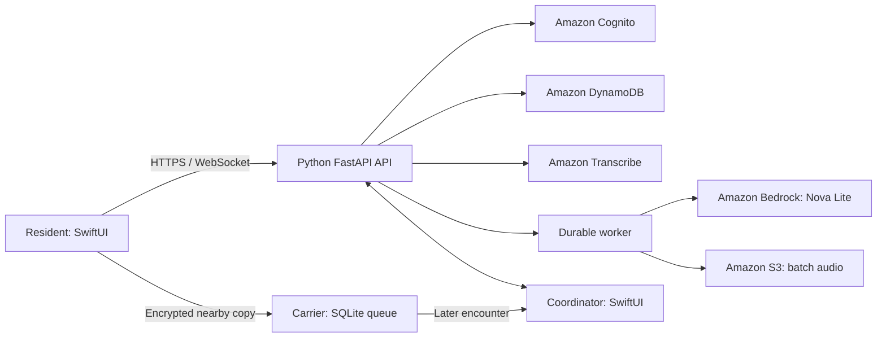

# RELAY

**Voice-assisted help requests with durable nearby delivery.**

Built for **SpartHill Hacks 2026 — AI for Sustainable Impact**, October 23–24,
2026, at San José State University, in the team's **AWS track** project.
The event brought together SJSU and Foothill College participants.
[Official event details](https://careercenter.sjsu.edu/events/2026/10/23/sparthill-hack-2026/)
· [Hackathon story and demo](HACKATHON.md)

RELAY connects residents asking for supplies with shelter coordinators reviewing
requests and managing stock. When internet is available, AWS handles speech,
structured extraction, authentication and shared state. The native Apple app also
stores messages locally and carries encrypted shelter requests through nearby
peer encounters. A continuous end-to-end connection is not required by the protocol.

**Project status:** hackathon prototype. The temporary demo server was shut down
on October 26, 2026. This repository does not provide a live public service or demo
credentials. Physical three-device, router-independent wireless acceptance remains
unverified; automated and same-host controls are documented separately.

## What is implemented

| Area | Capability |
| --- | --- |
| Resident | Speak or type a request; review extracted fields; select a shelter; attach a location snapshot or typed landmark; track progress. |
| Speech and AI | Amazon Transcribe streaming, explicit batch retry, Amazon Bedrock Nova Lite structured extraction, validation and manual correction. |
| Coordinator | Shelter inbox, request conversation, human approval, stock reservation, handover and release. |
| Inventory | Conditional, idempotent ledger operations prevent duplicate reservations and overbooking. AI cannot authorize allocation. |
| Nearby delivery | Bonjour discovery, Network.framework TCP framing, persistent SQLite queue, inventory exchange, retries, deduplication, expiry, hop limits and return receipts. |
| Request protection | Encrypted shelter envelopes and signed destination receipts using CryptoKit. Legacy nearby chat remains plaintext. |
| Identity | Cognito accounts and server-configured shelter memberships, separate from each device's persistent UUID and cryptographic keys. |
| Personal details | Optional local photo and health/support details; explicit per-request sharing; required name/language only when saving a profile; setup can be skipped. |
| Accessibility | Adjustable text and contrast, first-use walkthrough, labeled resource choices, keyboard dismissal and system-voice announcement reading. |
| Alerts | Staff-published incident announcements with priority, expiry and withdrawal; downloaded notices remain readable offline. |

## Online and offline behavior

| Operation | Internet available | Internet unavailable |
| --- | --- | --- |
| Save a typed request | Durable local queue, then sync | Durable local queue |
| Transcription and extraction | AWS Transcribe and Bedrock | Type and review fields manually |
| Deliver to shelter | HTTPS and eligible nearby delivery | Nearby encounters with an enrolled receiver |
| Confirm destination storage | Signed receipt through nearby return encounters | Same stored receipt mechanism |
| Replies, approval and inventory | Authenticated cloud synchronization | Wait for reconnection |
| Announcements | Fetch current feed | Read downloaded notices; updates need cloud |

An intermediate phone can carry ciphertext while the original sender is absent.
A relay ACK means a copy was stored; a destination receipt means the addressed
device saved it. Neither is staff approval or proof that aid was physically delivered.
Keep participating apps open during encounters. First-time account and shelter-key
setup must be completed online. Range, background operation and field reliability
are not established by these tests.

## Architecture and technologies



- **Apple client:** Swift, SwiftUI, Network.framework, Bonjour, SQLite and CryptoKit.
- **Backend:** Python 3.13, FastAPI, Pydantic, boto3, WebSockets and SQLite/DynamoDB adapters.
- **Hackathon hosting:** Mac API/worker behind a Cloudflare tunnel and CloudFront.
  This was a supervised demo, not a managed AWS compute deployment.
- **Team repository:** the separate React/Expo work lives in
  [RELAY-Sparthill2026](https://github.com/AdityaDave2008/RELAY-Sparthill2026).
  Its API contracts and transport are not interchangeable with this native app.
  Android native radio integration is not implemented here.

## Run the nearby prototype

Requirements: a Mac with Xcode and Swift 6 or later. Deployment targets are iOS 17
and macOS 14. The recorded development toolchain was Xcode 26.1.1 / Swift 6.2.1.
The Swift package has no third-party dependencies.

```sh
git clone https://github.com/NikilTn/relay.git
cd relay
swift test
open RELAY.xcodeproj
```

Select `RELAY-macOS` to run on the Mac or `RELAY-iOS` for a simulator/phone.
For physical iPhones, choose your own signing team and unique bundle identifier,
trust the Mac, and enable Developer Mode when Apple requires it.
No signing team, certificate or provisioning profile is supplied.

The signed-out app offers **Open nearby test lab** for account-free transport
experiments. Use synthetic messages: the legacy lab is not an authenticated
shelter workspace. Its roles and forced routes are diagnostic controls.
Allow the normal Local Network permission prompt.

```sh
# Compile without installing or starting a server.
xcodebuild -project RELAY.xcodeproj -scheme RELAY-macOS \
  -configuration Debug -destination 'platform=macOS,arch=arm64' \
  -derivedDataPath /tmp/relay-mac-build build

xcodebuild -project RELAY.xcodeproj -scheme RELAY-iOS \
  -configuration Debug -sdk iphonesimulator \
  -destination 'generic/platform=iOS Simulator' \
  -derivedDataPath /tmp/relay-simulator-build CODE_SIGNING_ALLOWED=NO build
```

Read [TEST_PLAN.md](TEST_PLAN.md) for exact physical test conditions. Turning on
`includePeerToPeer` or succeeding over a common Wi-Fi router does not establish
infrastructure independence.

## Run backend tests without AWS

```sh
python3.13 -m venv cloud/.venv
cloud/.venv/bin/python -m pip install -r cloud/requirements.lock
cloud/.venv/bin/python -m pytest cloud/tests -q
```

These use synthetic identities, fixture providers and temporary SQLite stores.
They do not invoke AWS or need cloud credentials. For the optional local API and
worker, see [cloud/README.md](cloud/README.md). Starting either is an explicit step;
cloning/building the repository does not start a service.

## Configure your own cloud deployment

Cognito identifiers and API URLs are public configuration, not credentials.
The app has no workshop endpoint or sign-in client configured by default.
Set your own values when generating the Xcode project:

```sh
RELAY_CLOUD_API_URL=https://api.example.invalid \
RELAY_COGNITO_CLIENT_ID=YOUR_PUBLIC_CLIENT_ID \
RELAY_COGNITO_LOGIN_URL=https://YOUR_DOMAIN.auth.us-east-1.amazoncognito.com \
RELAY_TEAM_ID=YOUR_APPLE_TEAM_ID \
RELAY_BUNDLE_ID=YOUR_UNIQUE_BUNDLE_ID \
python3 scripts/generate_project.py
```

Replace every example value. The AWS integration currently targets `us-east-1`.
Register `relay://oauth/callback` for the secretless Cognito client and provision
separate resident/coordinator memberships. Keep AWS credentials on the server.
CLI cloud probes accept the same `RELAY_COGNITO_*` environment variables.
Do not commit private runtime files or generated deployment-specific changes.

See [backend setup](cloud/README.md), [API contract](cloud/openapi/relay-v1.yaml),
[deployment limitations](cloud/docs/DEPLOYMENT.md), and
[security boundaries](SECURITY.md). The infrastructure template is a deployment
starting point; it is not evidence of a running Lambda service.

## Verification and contributing

- [Test results](TEST_RESULTS.md): actual evidence, including unverified physical claims.
- [Publication review](docs/PUBLICATION_REVIEW.md): cleanup scope and current validation.
- [Contribution guide](CONTRIBUTING.md): formatting, tests and safe changes.
- [Resident data handling](docs/RESIDENT_SETUP.md) and [nearby envelope](cloud/docs/NEARBY_DELIVERY.md).

Historical evidence was sanitized for publication: personal paths, private email
addresses, hardware IDs and old UI screenshots were removed or replaced. Source
checksums in old evidence describe those historical builds, not the current code.
No credentials, runtime databases, recordings from real users or signing material
are required to build the source.
