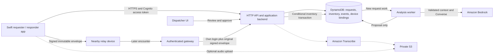

# RELAY cloud MVP plan — Team 2

Prepared 2026-10-23 PDT. This is a proposed implementation, not a deployment record. See `AWS_ACCESS_REPORT.md` for account evidence and remaining checks.

## Decision

Build one resource-request workflow around **Bedrock Converse, deterministic inventory rules, and human dispatcher approval**. Use text input first. Preserve the existing Swift app's durable message IDs and local relay behavior; add cloud synchronization as another transport.

The live workshop account has a material IAM constraint: the participant can pass only `WSParticipantRole`, whose trust policy does not include Lambda. The inspected policies do not allow normal role creation or trust-policy changes. Therefore, the usual API Gateway + Lambda deployment needs organizer assistance before it is a supported deployment path. Listing services does not prove their write/runtime operations.

**Preferred path, after the IAM gap is resolved:** Cognito user pool → API Gateway HTTP API → small Lambda API/worker → DynamoDB, Bedrock, and optional S3/Transcribe. Keep resources in `us-east-1`.

**Timeboxed fallback if the organizer cannot resolve it promptly:** run the same backend on the team's Mac, using an operator-configured temporary workshop session to call Bedrock and DynamoDB. Keep AWS credentials only in the trusted backend process, never in the phone, browser, relay envelope, repository, or logs. This is a supervised demo deployment with a Mac availability dependency, not a resilient hosted service. An authenticated HTTPS endpoint on a controlled local demo network is sufficient; a public tunnel is a separate deployment decision. Do not expose an unauthenticated backend. Cloud runtime and data-write permission must still be tested after this audit phase.

For an AWS-hosted deployment, request a dedicated execution role with trust for `lambda.amazonaws.com`, narrowly scoped access to RELAY resources, and participant `iam:PassRole` limited to that role and service. Do not expand the powerful participant role's trust to Lambda. An organizer-provisioned stack is another acceptable route. Standard SAM/CDK templates that create IAM roles will not work with the currently visible permissions.

## Smallest useful architecture



Use two small backend entry points: an API handler and an asynchronous analysis worker. A DynamoDB stream can deliver new-request work to Lambda; the local fallback uses a bounded poller over a dedicated work index. A persisted processing state and lease are required in either implementation. Do not rely on a background thread continuing after an HTTP response.

Use one DynamoDB table with explicit item types for requests, command idempotency, inventory, assignments, device bindings, and events. A small incident can use one event sequence counter with optimistic concurrency; document the hot-key limit and split by incident later. Use on-demand capacity. Keep a small, versioned synthetic procedure set in application code or private S3. A vector database, Knowledge Base, AgentCore runtime, Step Functions, and SageMaker endpoint are unnecessary for this workflow.

Existing groundwork was discovered: `relay-messages` has string `pk`/`sk` keys; Cognito pool `RELAY-Dispatchers-SpartHill` (`us-east-1_f7wyKUgiY`) exists; S3 buckets `relay-artifacts-928489693154-use1` and `relay-public-webbucket-twmcadnxx1le` exist. Validate ownership/schema and auth/bucket policies, then reuse suitable pieces. Do not create a second identity system or assume that a bucket name proves its access policy. Keep request/audio objects private and separate from web assets. No user records, object contents, or secrets were opened during the audit.

Use `amazon.nova-lite-v1:0` as the first evaluation candidate, subject to account availability and runtime verification. Official documentation supports in-region Converse in `us-east-1`. A US inference profile (`us.amazon.nova-lite-v1:0`) is an alternative only after checking account quotas and all destination-region policies. The workshop policy exempts `bedrock:Invoke*` from its regional deny; this does not prove that cross-region inference is allowed by all policies. [Nova Lite model documentation](https://docs.aws.amazon.com/bedrock/latest/userguide/model-card-amazon-nova-lite.html), [inference profiles](https://docs.aws.amazon.com/bedrock/latest/userguide/inference-profiles-support.html).

The live console lists Nova Lite and shows account quotas of **4 million tokens/minute and 2,000 requests/minute on-demand**, or **8 million tokens/minute and 4,000 requests/minute for Geo cross-region**. Use the simpler in-region route first. These values do not prove inference entitlement or available capacity. The model card says use agrees to an EULA; review terms before the first paid runtime test.

Bedrock extracts item, amount, unit, location, urgency cues, negation, and missing fields. It may explain a proposed response using supplied inventory/procedures. Validate its output against a strict schema and known item/location IDs. Preserve the source text. Reject unknown units, invented locations, negative quantities, ungrounded inventory, and malformed output. Missing or ambiguous fields become a clarification request.

The model cannot reserve stock, choose its own permissions, approve an assignment, or mark fulfillment. A dispatcher reviews the proposal. The backend rechecks current inventory and authorization in an atomic transaction at approval time. Any model tool request is only a proposal; deterministic code decides whether a read-only tool is allowed. Put user text and procedure content in data fields, not privileged instructions.

## API contract

All routes are under `/v1`. Require authentication and server-side incident membership. Every mutation carries a globally unique `operation_id`; retries reuse it. The request's canonical `request_id` equals the original relay `message_id` UUID and never changes across direct upload, relay upload, or retries. Separate receipt/event IDs from request IDs.

| Method and route | Caller | Contract |
|---|---|---|
| `POST /devices/enroll` | Authenticated user | Bind device public key and existing device UUID to verified user subject; return public enrollment certificate and offline scope/expiry. No AWS credentials returned. |
| `POST /requests` | Requester | Submit immutable signed request envelope. Return `201` only after durable cloud acceptance; same ID and same content returns `200` and existing result. Same ID with conflicting immutable content returns `409`. |
| `GET /requests/{id}` | Owner or authorized staff | Return structured request, proposal, revision, assignment, fulfillment state, and authorized event history. |
| `POST /sync/push` | Signed-in device or gateway | Accept a bounded batch of original signed envelopes/commands. Return a result per item: accepted, already accepted, expired, conflict, unauthorized, or retryable. One bad item must not hide successes. |
| `GET /sync/pull?cursor=...&limit=...` | Signed-in device | Return authorized events and opaque cursor. Cursor binds to user/incident/query scope; do not advance before local durable commit. Return reset instructions if cursor retention has expired. |
| `POST /transcriptions` | Requester | Allocate `transcription_id` and a short-lived upload authorization for one private object; enforce size, media type, owner, duration, and checksum limits. No transcription starts until upload completion is confirmed. |
| `POST /transcriptions/{id}/start` | Owner | Verify uploaded object and start one uniquely named batch job; repeated calls return the same job. No caller-supplied arbitrary S3 path. |
| `GET /transcriptions/{id}` | Owner | Return pending/complete/failed and editable transcript. Transcribe output does not submit a request automatically. |
| `POST /requests/{id}/revisions` | Owner before approval, or dispatcher | Append corrected text/fields using `expected_revision`; preserve prior versions. Reanalysis is explicit and bounded. |
| `POST /requests/{id}/assignments` | Dispatcher | Send `operation_id`, `expected_revision`, responder, inventory location, item and quantity. Validate membership and stock; atomically reserve inventory, create assignment, update request, and append event. |
| `POST /assignments/{id}/events` | Assigned responder | Accept/progress/complete with unique event ID and expected version. Enforce state transitions and completed quantity ≤ reserved quantity. |
| `POST /assignments/{id}/cancel` | Dispatcher | Transactionally release unfulfilled reservation once; repeat is idempotent. Delivered stock is not silently restored. |
| `POST /requests/{id}/analysis-retries` | Dispatcher | Bounded explicit retry for failed analysis. Preserve failed attempt metadata. |

Example immutable request payload (illustrative values):

```json
{
  "schema_version": 1,
  "operation_id": "10000000-0000-0000-0000-000000000001",
  "request_id": "10000000-0000-0000-0000-000000000001",
  "origin_device_id": "00000000-0000-0000-0000-00000000000a",
  "incident_id": "synthetic-demo-01",
  "created_at": "2026-10-24T04:00:00Z",
  "expires_at": "2026-10-25T04:00:00Z",
  "payload": {"text": "SYNTHETIC: Shelter A needs 20 water packs", "input_mode": "text"},
  "key_id": "enrolled-device-key-01",
  "signature": "<signature-over-canonical-immutable-fields>"
}
```

Cryptographically verify identity from the enrolled key; an `origin_device_id`, display name, claimed user ID, or `gateway_id` field alone is not authentication. Hop count, route, retry timestamps, and gateway observations belong in separate transport metadata outside the signed immutable payload. Establish one canonical serialization and cross-language Swift/backend test vector before implementation.

Response after durable acceptance:

```json
{
  "request_id": "10000000-0000-0000-0000-000000000001",
  "cloud_state": "accepted",
  "analysis_state": "pending",
  "revision": 1,
  "assignment": null,
  "fulfillment_state": "not_fulfilled"
}
```

Use `400` for schema errors, `401` for invalid online login, `403` for role/ownership/signature failure, `409` for content/version/stock conflict, `410` for expired request, and `429` with retry guidance for throttling. A timeout is an unknown outcome: retry the same operation ID or read its status. Never create a fresh ID merely because an ACK was lost.

## Delivery states and duplicate control

Keep delivery, analysis, assignment, and fulfillment as separate state fields. Show these milestones plainly:

1. **Saved on this device:** local transaction completed.
2. **Stored by a nearby relay:** another device durably accepted the envelope.
3. **Received by the cloud:** backend durably accepted and authenticated it.
4. **Ready for dispatcher review:** validated analysis exists, or manual clarification is needed.
5. **Approved and assigned:** dispatcher authorized a successful inventory reservation.
6. **Accepted / in progress / fulfilled:** responder reports separately; fulfillment is not inferred from delivery or approval.

The existing final-destination receipt still means transport delivery, not cloud processing or resource fulfillment. Add new, clearly typed signed cloud/domain events rather than relabeling the old ACK. A gateway's assertion of cloud success is insufficient: forward a server-signed receipt or verify by authenticated status lookup after recovery.

At submission, conditionally insert the request and payload hash. Authenticate/authorize before revealing an existing request. Preserve idempotency records longer than the maximum relay TTL, retry window, and clock-skew allowance (propose 30 days for a 7-day maximum message TTL); do not rely on DynamoDB's roughly ten-minute transaction client-token window for durable duplicate protection. Expiry blocks new processing even before physical TTL cleanup happens.

Approval transaction: conditionally insert command ID, update request with expected revision and unassigned state, decrement available inventory only if sufficient, increment reserved quantity, create assignment, and append event plus sequence update. Put checks in the relevant item update; DynamoDB does not allow a separate condition check and update targeting the same item in one transaction. Two dispatchers racing for the last stock must produce one winner. [DynamoDB transaction semantics](https://docs.aws.amazon.com/amazondynamodb/latest/developerguide/transaction-apis.html).

Completion moves reserved quantity to fulfilled exactly once. Partial completion tracks delivered and remaining quantity; cancellation releases only the remaining reservation. Counter/assignment/request changes must commit together. Never use last-writer-wins to merge stock or assignment decisions.

The worker acquires a conditional lease, calls Bedrock, and conditionally writes its result against the same request revision. A crash after inference but before persistence can cause a repeated paid inference call; exactly-once external inference is not guaranteed. Deduplication guarantees one logical accepted request and one successful allocation, with bounded inference retries and measured cost. Stale worker output cannot overwrite a corrected request.

## Authentication and offline identity

Use Cognito **user pools**, Authorization Code with PKCE for native/public clients, short-lived access tokens, and protected refresh tokens in Keychain. API Gateway validates issuer/audience/scopes; application code validates current group/incident membership and record ownership. Never put a client secret in a native app. Do not use Cognito Sync, which is a different legacy product. [HTTP API JWT authorization](https://docs.aws.amazon.com/apigateway/latest/developerguide/http-api-jwt-authorizer.html).

| Actor | Allowed actions |
|---|---|
| Requester | Create and read own requests; correct a pending request; cannot approve allocations. |
| Dispatcher | Review incident requests, correct proposals, approve/cancel assignments, and reconcile stock. Membership is assigned by a trusted administrator, not self-selected at signup. |
| Responder | Read assigned tasks and append permitted progress/completion events; cannot assign themselves arbitrary stock. |
| Relay gateway | Upload envelopes with its own authenticated session; cannot impersonate origin or read unrelated request history. |

During online enrollment, generate a signing key on the originating device and bind its public key to the authenticated Cognito subject. The backend can issue a signed public certificate containing device/key ID, subject, incident, narrow offline scopes, and expiry. A relay carries this certificate and the signed request, **never the origin user's password, access token, refresh token, or AWS session**. On recovery, the gateway authenticates itself, and the backend independently verifies the original sender's signature, enrollment, scope, expiry, revocation, and request ID.

Offline authorization is intentionally narrower: queue a request or responder observation; do not finalize globally constrained stock allocations offline. Clock claims alone cannot prove when a disconnected message was signed. Reject or route expired/revoked/uncertain submissions to explicit review; do not silently widen the offline window. A device never enrolled online can save a local draft, but its claimed identity remains unverified until enrollment or operator reconciliation.

Current RELAY transport/storage is plaintext and display names are unauthenticated. Signed envelopes add integrity/authenticity, not confidentiality. For the synthetic demo, label this limitation. Real deployments require encrypted payloads for authorized recipients, protected local storage, key rotation/revocation, and a threat review. No production emergency-service claim follows from the demo.

## Speech baseline

Ship text first, then optional batch Transcribe for short recorded clips. It minimizes streaming infrastructure and lets the user review/correct the transcript before a request ID is committed. Keep recordings on the device during an outage or allow text entry; Bedrock and Transcribe do not work during cloud loss.

Evaluate 30 synthetic utterances: 10 clean, 10 noisy, 10 telephone-band/8 kHz, covering quantities, place names, corrections, and negation (for example, “Do not send 20; send 2 to Shelter B”). Measure word error rate, exact quantity/unit/location/negation extraction, correction rate, upload/transcription latency, and end-to-end p50/p95. Inspect critical-field mistakes even when aggregate word error rate looks good. Report the small sample's limits.

Use the actual sample rate and a supported format/language; do not label resampled 8 kHz audio as restored high-quality audio. Try microphone/preprocessing, a vocabulary for shelter/item names, and transcript confirmation before considering training. SageMaker custom ASR needs a measured baseline failure, representative labeled data, separate cost approval, and a valid service execution role; it is outside the hackathon critical path.

## Implementation order and acceptance gates

The event page gives about 18 build hours across two days, but this audit is late Friday. The listed video deadline is Saturday at 10:30 AM; confirm the event's timezone with the organizer. Do not confuse the 72-hour account session with the submission deadline. Protect time for recording/uploading the video.

| Priority | Work | Estimate | Acceptance evidence |
|---|---|---|---|
| 0 | Resolve execution-role gap; confirm Team 2 account mapping, credit ceiling, remaining Lambda concurrency, and chosen Bedrock model quota | 30–45 min | Organizer-provided role or explicit local-backend decision; no vague “admin access” assumption |
| 1 | Approved tiny Converse test, then backend acceptance and read endpoints with synthetic inventory | 1.5–2.5 h | Actual Bedrock output and usage; schema checks; durable request and payload-hash dedupe |
| 2 | Dispatcher and responder workflow using the same app identity model | 1.5–2 h | Request → model proposal → human approval → responder completion; inventory audit trail |
| 3 | Cloud adapter/outbox, origin signatures, gateway upload, and returning cloud events | 2–3 h | Same request ID direct and relayed; crash/retry does not duplicate request or allocation |
| 4 | Physical outage/recovery rehearsal and adversarial checks | 1–1.5 h | Three-device evidence, network conditions, exact IDs, one allocation, receipts retained after restart |
| 5 | Optional Transcribe baseline and editable transcript | 1–1.5 h | Critical fields evaluated; user confirms transcript; text works when offline |
| 6 | Polish, record, inspect, and upload five-minute video | 1–1.5 h | Watch the exported video; architecture and actual Bedrock use visible; finish before deadline |

These are planning estimates for team work, not promises. If time is short, cut speech, vector search, and agent orchestration first. Keep the online end-to-end workflow and honest recovery demonstration. A fully authenticated cloud/relay integration may exceed one person's remaining overnight window; do not present unfinished security or radio tests as complete. Prepare the video early enough that optional work cannot jeopardize submission.

Do not modify or regenerate mobile project signing, TestFlight settings, personal-chat behavior, or unrelated Dreamer/HPC files while adding the cloud adapter. Existing records need a versioned migration; preserve UUIDs and return receipts. The existing `RESOURCE_REQUEST` message is not yet a signed cloud command. Introduce a compatible versioned payload/adapter and test unsupported-version behavior.

Meaningful tests to write during implementation:

- Same signed request arrives directly and via two gateways, including lost response/restart: one logical request, identical accepted content, one current result.
- Same UUID with changed content is rejected; mutable hop metadata does not cause a false conflict.
- Concurrent approvals for insufficient remaining stock: exactly one reservation succeeds; no negative available stock.
- Repeated completion/cancellation and stale revision commands do not double-decrement or restore delivered stock.
- Requester cannot dispatch; responder cannot update another responder's assignment; gateway cannot change origin, read unrelated data, or upload an expired/revoked certificate as current authority.
- Worker crash after model invocation can retry, but no second assignment is created; late results cannot replace a newer revision.
- Local queue survives process termination. Sync cursor moves only after local commit. Partial batch results and server-side expired cursors recover without losing messages.
- Quantity, location, negation, and prompt-injection examples are handled by validation/review; no model suggestion performs a write.

## Five-minute demo

Persona: a shelter-supply dispatcher coordinating water deliveries during an internet outage. Use a clearly marked synthetic incident and inventory, for example 50 water packs at Depot 1 and two named demo shelters.

1. **0:00–0:35:** Explain the dispatcher and continuity problem. Show the simple architecture and state that offline mode preserves requests; AI analysis resumes when AWS is reachable.
2. **0:35–1:45:** Requester submits “Shelter A needs 20 water packs.” Show the actual Bedrock-backed extracted fields, available inventory, and rationale. Dispatcher reviews and approves. Display stock/reservation change.
3. **1:45–2:15:** Assigned responder accepts and reports completion. Show the same request history and the distinction between assignment and fulfillment.
4. **2:15–3:30:** Disconnect the requester from internet, save another request, and show “Saved on this device.” Foreground relay B durably accepts it. Stop A; restart B to show persistence. Later bring B to the gateway C. Keep Wi-Fi radios on, remove conventional router/cellular/tethering paths, and record the actual test conditions before claiming router independence.
5. **3:30–4:20:** Restore C's AWS connectivity. Upload the original request ID; replay it again from A/B. Show one cloud record and one allocation. Return a verifiable cloud acceptance event to A. Do not show a transport receipt as fulfillment.
6. **4:20–5:00:** Show failure behavior, the visible audit trail, cost, and limitations: foreground Apple-only encounters, no guaranteed background delivery, physical acceptance results actually obtained, and synthetic-data security scope. Include the organizer-specified team contact channel.

If physical radio conditions cannot be verified, present the software recovery test explicitly as a controlled demonstration and avoid claiming a proven infrastructure-independent mesh. A prerecorded successful run is useful backup evidence, but label when it was recorded and do not disguise it as live behavior.

## Demo cost estimate

USD list-price estimate for **three days**, excluding taxes and unrelated workshop/system resources. Assume no free-tier or hackathon credit entitlement. All figures are incremental, not an account bill forecast.

| Component | Explicit workload assumption | Estimated cost |
|---|---|---:|
| Nova Lite standard on-demand | 200 requests × 2 model calls; each call 1,000 input + 250 output tokens; total 400k input + 100k output | $0.048 |
| Batch Transcribe | 100 clips × 30 seconds = 50 minutes; $0.006/minute | $0.30 |
| Alternative streaming speech | Same 50 minutes; about $0.010002/minute; replaces batch cost | $0.50 |
| HTTP API | 20,000 small calls at $1/million | $0.02 |
| Lambda, conditional on valid role | 20,000 invocations, 512 MiB, average 0.5 s; 5,000 GB-s + request charges | about $0.09 |
| DynamoDB | Budget allowance for ≤20k small writes, ≤50k small reads, transaction amplification, <100 MB storage, bounded worker polling | $0.25 allowance |
| S3, logs, transfer | ≤100 MB audio, ≤50 MB logs, ≤5k object requests, small egress, three-day retention | $0.25 allowance |
| Cognito | Up to 10 demo users; reserve an allowance even if eligible free tier applies; no SMS/M2M token fleet | $0.25 allowance |
| **Total with batch ASR** | Calculated items plus conservative small-service allowances | **about $1.21** |

Set a **planning ceiling of $5 incremental demo spend** to cover repetitions and retries. This is a recommendation, not a configured AWS Budget or authorization to spend. CloudWatch/other workshop resources may already accrue charges. The live credits page showed no credits and `$0.00` balances, and Budgets showed onboarding with no budget displayed. Workshop funding may be centralized; the team allowance and covered services remain organizer questions.

Current official public price-list files were checked on the audit date: Nova Lite input `$0.00006/1K tokens`, output `$0.00024/1K`; Transcribe batch `$0.0001/second`, streaming `$0.0001667/second`. These differ from older Transcribe tutorials quoting a standard 15-second minimum and higher per-minute rates. Current standard-transcription pricing states one-second billing without a minimum. The allowances above are estimates, not individually quoted tariffs.

Sources: [Bedrock regional price list](https://pricing.us-east-1.amazonaws.com/offers/v1.0/aws/AmazonBedrock/current/us-east-1/index.json), [Transcribe regional price list](https://pricing.us-east-1.amazonaws.com/offers/v1.0/aws/transcribe/current/us-east-1/index.json), [Transcribe pricing](https://aws.amazon.com/transcribe/pricing/), [API Gateway pricing](https://aws.amazon.com/api-gateway/pricing/), [Lambda pricing](https://aws.amazon.com/lambda/pricing/), [DynamoDB pricing](https://aws.amazon.com/dynamodb/pricing/on-demand/), [S3 pricing](https://aws.amazon.com/s3/pricing/), [Cognito pricing](https://aws.amazon.com/cognito/pricing/).

Avoid always-running GPU/SageMaker/Marketplace endpoints, provisioned Bedrock throughput, NAT gateways, OpenSearch clusters, and unbounded polling/logging for this demo. One published Nova Lite no-commit provisioned-throughput model unit is **$60.50/hour** in this region—vastly more than the proposed on-demand demo. Do not create it.

At implementation time, use bounded retries with jitter, per-user request/audio limits, worker concurrency limits, short log retention, private S3 lifecycle expiration, and clear resource ownership tags. Budgets notify; they are not a hard spending cap.

## Cleanup after the event

Maintain an explicit manifest of resources created by this project. Export the synthetic demo evidence and needed configuration before workshop access expires, without credentials. Stop request generation and workers; remove only the team's newly created API, functions, event mappings, auth pool, test jobs, storage objects/versions, tables, and logs according to the agreed retention plan. Check dependent resources and any endpoint/provisioned capacity before declaring cleanup complete. End temporary local sessions and stop the fallback server.

Existing RELAY DynamoDB, Cognito, and S3 resources were found during the audit. Establish their owner and intended use before reuse or cleanup; the plan does not authorize overwriting or deleting them. Do not alter workshop control-plane roles, system functions, service-linked roles, or unrelated resources. Do not assume automatic workshop teardown is immediate or preserves artifacts.
